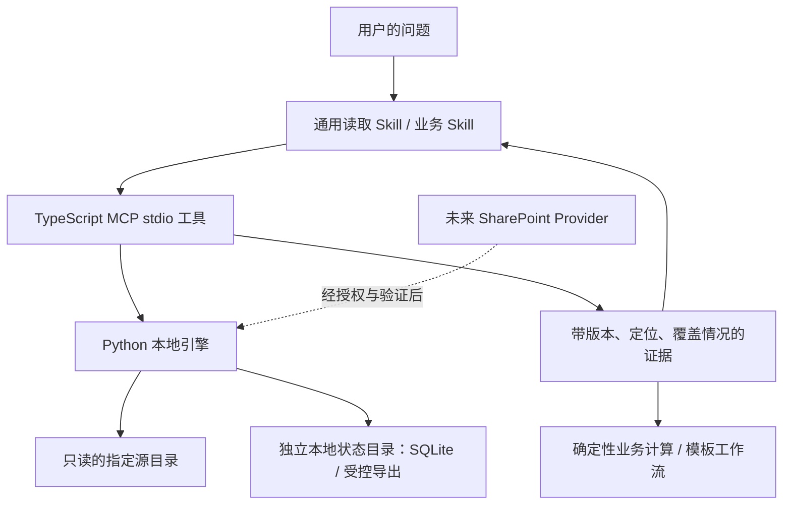

# 团队 Agent 开发方案与实现边界

更新日期：2026-10-23。本文是公开、去身份化的开发规格，描述一个约 8 人团队的参考场景；不包含实际团队成员、公司资料、账户、租户、授权令牌或本机路径。

本项目交付的是**可由 AI 调用的本地只读文件服务，以及配套 Skill**。真实数据接入、团队身份认证、SharePoint 连接和业务正式上线不因公开代码而自动完成。实际构建、测试与评估结果见 [VALIDATION.md](VALIDATION.md)，安装步骤见 [README](../README.md)。

## 1. 目标与优先顺序

团队希望每位成员能在自己的公司电脑访问一个助手，优先依据团队知识库回答，必要时再做明确区分的公开信息检索。首批用例：

1. 查询投放预算、已发生支出、承诺支出和余额。
2. 按固定模板生成汇报 PPT。
3. 查询 KOL 资料、比较报价与历史表现、准备营销方案。

初期先在一台个人电脑、个人 AI 账号下跑通 MVP；未来的数据来源为公司批准的 Microsoft 365/Teams/SharePoint。真实公司资料是否可发送给所选 AI 服务，应按公司的既定批准范围执行。个人 AI 账户不授予公司 Microsoft 365 数据权限。

优先级：**找对资料 → 正确提取 → 保持版本与口径一致 → 可核查引用 → 尽量快**。文件访问只是基础能力，业务成功标准是有人能用结果完成工作并复核关键依据。

## 2. 现有资产与此次公开项目的边界

此前另有一个独立的本地营销模拟原型，包含预算计算、KOL 筛选、简易知识检索、显式偏好记录和 5 页示例 PPT。它不随本仓库发布，不作为本项目依赖。

该原型使用模拟数据。预算与 KOL 历史数据是两套未对齐的数据集，不能凭相似项目编号合算 ROI；示例 PPT 未适配真实公司模板。模拟测试通过不代表已经接通公司业务系统。

本项目负责来源发现、正文读取、结构化定位、索引更新、版本校验及受控导出。不负责预算审批、正式 PPT 排版、KOL 外联或业务系统写入。业务 Skill 可以复用这里的证据，再执行各自的确定性工作流。

### 首次交付包含

- `team-drive-read` Skill：使用要求、读取 SOP、格式限制、完整性判断、错误恢复和引用标准。
- TypeScript MCP stdio 适配层：声明工具、校验输入、返回结构化结果。
- Python 3.9+ 本地引擎：受限根目录、SQLite 索引、格式提取、版本校验、分页与作业处理。首版要求 macOS/Linux，Windows 因缺少本实现依赖的安全 POSIX 文件访问机制而明确拒绝启动。
- 启动扫描与运行期间轮询更新，默认轮询间隔 30 秒。
- UTF-8 TXT、Markdown、CSV、TSV，以及 XLSX、DOCX、PPTX、文本型 PDF 的有限且明确的提取支持。
- 合成示例、程序测试和 10 道工具任务评估的验收框架。

### 首次交付不包含

- Microsoft Graph、Entra 登录、Teams/SharePoint 在线读取或组织权限同步。
- OCR、向量数据库、embedding 调用、自动摘要模型、视觉理解或公式重算。
- 操作系统原生文件监听、常驻系统服务安装、云服务器或多人共享后台。
- 原生 PPT 生成、KOL 平台接口、预算业务规则执行。
- 自动修改团队规则、训练模型或未经审核的自我改写。

技术实现与测试记录优先于本文的未来规划。未验证的性能目标不是产品承诺。

## 3. 为什么选择 Skill + MCP + 本地索引

`SKILL.md` 是 AI 的工作规范，不是持续运行的程序。它不能仅靠文字监听目录、解析 Excel 或维护数据库。

如果宿主允许运行脚本，Skill + 脚本可以完成单机试验；加入 MCP 的价值是让工具名称、输入输出和错误语义在不同宿主之间保持清晰。底层文件读取只开发一套，未来可以加入新的数据来源。

职责划分：

| 层 | 负责 | 不应承担 |
|---|---|---|
| 通用 Skill | 判断查找/完整统计、选择工具、解释证据、报告缺口 | 用提示词代替程序权限或版本校验 |
| 业务 Skill | 预算口径、报告字段、KOL 评价规则 | 假定检索前几条等于全部数据 |
| MCP 适配层 | 输入输出契约、工具发现、错误封装 | 业务事实裁决、任意执行代码 |
| 本地引擎 | 目录边界、索引、解析、版本、分页、导出 | 将缓存时间当作业务有效期 |
| 数据来源 | 实际文档和权威业务记录 | 通过文件文字给 AI 下系统指令 |

TypeScript 适配层与 Python 引擎属于明确的实施取舍：沿用 MCP 官方 TypeScript SDK，同时复用 Python 的标准库 SQLite 和文档处理生态。代价是需要两个运行时；锁定依赖并通过安装烟雾测试控制维护成本。

## 4. 成本与运行方式

| 成本项 | 首版处理 | 费用边界 |
|---|---|---|
| AI 对话与推理 | 使用现有宿主模型 | 消耗订阅或 API 额度，取决于宿主配置 |
| 文件解析与索引 | 本机 Python/SQLite | CPU、内存、磁盘、电力；无需模型调用 |
| MCP 运行 | 客户端启动本地进程 | 无需云服务器租金 |
| 数据库 | 本地 SQLite 文件 | 无托管数据库费 |
| OCR/向量/云摘要 | 首版未实现 | 引入时重新估算模型、存储与运维费用 |
| 团队共享服务 | 后续决定 | 可能增加服务器、身份、监控、备份费用 |
| 开发维护 | 测试、解析兼容、依赖升级、真实业务适配 | 早期最主要的实际投入 |

使用现有电脑且不增加付费外部服务时，新增云服务器及数据库托管费可以为零。文件服务不主动调用模型 API，不代表宿主模型也在本机运行或使用不计费。ChatGPT 订阅与 API 平台分别计费。[OpenAI 计费说明](https://help.openai.com/en/articles/9039756-managing-billing-for-chatgpt-and-the-api-platform)

SQLite 嵌入程序运行，不需要独立数据库服务器。[SQLite 架构](https://www.sqlite.org/serverless.html)

### 三种运行路径

| 路径 | 适用阶段 | 要补充的能力 |
|---|---|---|
| 本地宿主启动 stdio MCP | 当前单人 MVP | 安装依赖、配置指定根目录、让宿主发现 Skill |
| 每位成员各自运行 | 小范围试点 | 分发升级、每人各自授权、缓存隔离；Windows 支持仍须专门开发和测试 |
| 集中服务 + 远程 MCP | 需要全天候团队访问时 | 身份认证、按用户权限检索、TLS、限流、备份与运维 |

ChatGPT 网页端不会自动读取本机的 stdio MCP 配置。是否支持某种 Skill、插件或远程 MCP 连接，须按所选客户端、账户和管理员配置验证，不把本机连通当成全平台连通。

首版服务关闭、电脑休眠或关机后，不会持续更新。后续如果要独立于聊天软件运行，可增加本机服务管理配置；跨设备全天候访问才需要评估集中部署。

### 早期平台候选的取舍记录

下表保留早期研究方向，作为 2026-10-23 的暂定选择依据；没有为这些项目完成企业接入验收，采用前需重新检查版本、依赖许可、认证和实际部署成本。

| 方案 | 公开定位与本项目判断 |
|---|---|
| [Rakazo](https://github.com/elie222/rakazo) | 持续运行的 AI 团队平台，具有共享/私有计算环境等功能，公开项目标注 beta。更接近团队工作台候选，但内部知识库权限和本业务评估仍需单独验证。 |
| [OpenMuse](https://github.com/CopilotKit/OpenMuse) | 面向个人 Agent 的 alpha 模板。适合研究交互与持续任务，不据此假定已具备本团队需要的多人权限隔离。 |
| [OpenDots](https://github.com/CopilotKit/OpenDots) | 持续 Agent 工作台模板，部署和 CopilotKit Intelligence 配置需要另行安排。自托管模板不等于所有依赖、推理和团队治理均免费完成。 |
| 现有 AI 客户端 + 本 MCP | 最少新增基础设施，先验证真实任务；后续可以继续复用文件服务接口。当前优先路径。 |

## 5. 准确性的核心定义

“读准”包括四件事：找到适用且有权威性的来源、正确提取内容、使用一致版本、能定位到原始证据。

索引速度快并不能弥补业务定义缺失。例如一个数值来自真实文件，但草稿被当正式版、不同币种相加、报价与已付款重复计入，最终答案依然错误。

### 查找与完整统计分开

| 模式 | 例子 | 完整性要求 |
|---|---|---|
| 查找 lookup | 查合同的付款条件 | 选择适用文件，读取条款及必要上下文 |
| 完整 exhaustive | 所有项目总预算、最高支出项目、全部符合条件 KOL | 定义并枚举完整总体，检查全部相关来源、分页、重复与失败，再计算 |

检索 Top-K 不是完整总体。100 份相关文件只读成功 95 份时，可以提供明确范围的部分小计，不能称为完整团队预算。

“读取完成”需分别判断：选定范围的响应是否全部返回、解析器支持的内容是否全部提取、相关文件是否全部枚举、业务所需事实是否已经齐全。成功提取文字不等于理解了图片、版式或所有业务语义。

## 6. 建知识库：先建立来源地图和指标字典

不要求一开始迁移所有文件。先选择一个真实闭环所需的资料，保持现有文件位置，补充可维护的登记信息。

### 来源登记

建议字段：逻辑来源 ID、相对路径或未来的驱动器/文件 ID、业务主题、项目、资料状态、适用期间、维护角色、更新周期、替代来源和去重规则。来源登记本身也应有版本。

来源状态至少区分正式、草稿、历史参考；文件修改时间不能替代审批状态。登记由业务负责人维护，自动索引负责发现文件变化，不自动决定新文件是否成为正式依据。

[`sources.example.json`](../examples/sources.example.json) 是供业务 Skill/后续工具使用的合成参考配置；**首版服务不读取该文件做权威来源裁决**。

### 指标字典

预算需要：期间、币种、含税状态、正式预算版本、实际支出、未计入实际的承诺支出、余额算法、重复记录标识和舍入规则。

KOL 需要：统一项目与 KOL 标识、报价有效期、平台、表现观察窗口、互动/转化定义、归因边界、缺失数据处理。历史表现不能直接证明未来效果或因果关系。

PPT 需要：真实模板、每页字段、来源映射、图表计算、输出格式与人工认可的样稿。读取服务可以提供材料，但不能独自保证版式质量。

[`metrics.example.json`](../examples/metrics.example.json) 是参考定义；**首版不执行其中的公式**。确定性业务代码应另行验证并引用这些口径。

### 建议先完成一个闭环

一套经批准的脱敏预算资料 → 找出正式版本 → 确定性复算 → 带来源回答 → 填入真实 PPT 的指定页面 → 业务人员复核。该闭环比同时接入多个平台更能证明价值。

## 7. MCP 工具契约

采用统一 `team_drive_` 前缀。最终输入参数、上下界和输出字段以运行时 `tools/list` 返回的 schema 为准；更换 provider 不应悄悄改变完整性和权限语义。

| 工具 | 用途 | 调用后的必要判断 |
|---|---|---|
| `team_drive_status` | 查看索引、覆盖、配置限制和作业状态 | 初次扫描是否结束；是否有失败/排除项 |
| `team_drive_list` | 在范围内分页列出文件 | 消费后续页；区分被排除、未处理和可读取 |
| `team_drive_search` | 关键词与路径辅助检索 | 命中仅为候选；不把零命中当不存在 |
| `team_drive_inspect` | 查看文件结构和版本 | 理解工作表/页/段落等结构及警告 |
| `team_drive_read` | 读取指定证据范围 | 检查版本、定位、分页与覆盖 |
| `team_drive_export` | 将结构化内容导出为状态目录内的 JSONL | 检查版本、条数、警告；交确定性程序计算 |
| `team_drive_refresh` | 请求刷新本地索引 | 异步作业需查看最终状态 |
| `team_drive_job_status` | 查看扫描作业结果 | 失败或取消不等于成功 |
| `team_drive_cancel` | 请求停止不再需要的索引作业 | 取消是本地状态操作，源文件不变 |

通用证据应保留相对路径、文件身份、内容版本、修改元数据、实际定位、解析警告、分页状态、读取范围和扫描时间。具体返回形状以代码为准，不能由 Skill 臆造字段。

已实现接口的精简参数表见 [工具参考](../skills/team-drive-read/references/tools.md)。`read` 支持 `selector`：CSV/TSV 行范围；XLSX 指定工作表及可选行范围；PDF 单页；PPTX 单张幻灯片。行/页/幻灯片以 1 起算，不同格式的选择条件不能混合。尚未提供 A1 列范围裁剪。

无 selector 时，`start` 使用零起点的原文件 segment 序号，可由 `inspect` 获取。使用 selector 时，`start` 是筛选结果中的零起点偏移；返回的 `ordinal` 仍是原文件段序号。续读游标绑定 selector，不能换条件后继续。文本 `inspect` 的 `line_bucket` 是 200 行导航桶，边界不代表文件真实末行；引用应依据 `read` 返回的实际行定位。

`expected_version` 对 `read` 可选但 Skill 要求在证据链中传入；对 `export` 必填。

`coverage.inventory_complete` 表示目录枚举完成，`all_present_files_indexed` 表示所有当前条目都处于 ready；`business_completeness` 明确保持 `not_established`。`extraction_complete` 只表明支持范围内的解析完成，不涵盖图片视觉或业务总体。`truncated` 与 `has_more` 对应分页，不表示解析器悄悄截取正文。

`total_matching_segments` 是选择条件命中的段数，`total_segments` 是整个文件提取出的段数。`selection_complete_in_response` 只判断本次响应是否包含全部选中段；`whole_file_in_response` 对所有筛选读取均为 false。零匹配保留来源版本并返回空数组，不等于业务数值为零。

MCP 返回结构化结果并提供可操作错误。stdout 只用于协议；日志走 stderr。工具注解描述副作用，但不能替代底层安全检查。`refresh`、`cancel`、`export` 会修改本地状态，不能因为源文件只读就把它们描述成完全无副作用。

导出路径由服务生成：`artifact_id` 相对状态目录，`artifact_path` 是供本地分析工具使用的运行时绝对路径；不允许模型任意指定外部写入路径。`row_count` 是 JSONL segment 数量，不等于业务表行数。导出包含整个文件的受支持提取内容，不继承先前 read 的 selector，业务过滤由后续确定性程序明确执行。

导出文件仍可能包含内部资料，不因它是工具产物就自动允许上传。公开验收记录、issue 和日志不能直接复制含个人运行时路径或内部正文的完整工具轨迹。

### 命令行诊断与会话

在安装完成的仓库目录中执行 `node scripts/call-tool.mjs --help` 查看用法，`node scripts/call-tool.mjs tools` 列出真实工具 schema。诊断 CLI 每次启动并关闭一个服务会话；普通调用会等待启动索引，最多 60 秒，refresh 也会等待对应作业。超时不意味着索引成功，大目录应使用保持连接的 MCP 客户端。

游标绑定会话，不应在多次独立 CLI 调用之间传递分页游标。诊断进程也受单状态目录单 worker 限制；已有客户端占用该状态时，使用独立测试配置，或明确关闭旧连接后诊断。

## 8. 读取 SOP

1. 明确项目、期间、范围及查找/完整统计模式。
2. 查看索引覆盖；需要时刷新并确认作业终态。
3. 用枚举和关键词寻找候选，使用项目代码、简称和中文同义表达交叉检查。
4. 根据显式审批状态、适用期间和来源地图选择版本；无法判定则报告冲突。
5. 先检查结构，再读取目标内容及表头、单位、脚注、限制条款等上下文。
6. 多次读取绑定同一版本；源文件变化后重启该文件的证据链。
7. 完整统计枚举全体相关文件、处理所有分页、核对失败与重复；导出后用确定性程序计算。
8. 回答给出原始文件、版本和真实定位；单独说明未完成部分。

正式 Skill 的执行版本位于 [SKILL.md](../skills/team-drive-read/SKILL.md) 和其 `references/`。这里保留总体设计，不复制工具参数的全部细节。

内部资料优先并不意味着自动开放公网搜索。用户需要公开信息时，交宿主已授权的检索工具，外部来源单独标注；内部预算、审批、合同缺口不能靠公开网页猜测。

## 9. 索引数据库与自动更新

### 为什么用数据库

文件很多时，每次问答重新扫目录和解析全部正文会浪费时间。SQLite 保存可查询的文件清单、提取结果及版本信息，普通查询先在数据库中定位，再验证和读取来源。

数据库放在本机非同步状态目录，不与源目录嵌套。可以导出人能阅读的清单，但不以单个巨大 Markdown/JSON 文件替代索引。

### 必须保存的信息

| 逻辑数据 | 作用 |
|---|---|
| 文件记录 | 相对路径、类型、大小、版本、扫描标记、解析状态和失败原因 |
| 内容单元 | 文本/结构数据、原始定位、文件版本与解析器版本 |
| 检索数据 | 可搜索内容与中文检索词；用于发现候选 |
| 索引元数据 | 根目录身份、索引代次、最后扫描时间、覆盖情况 |
| 作业记录 | 刷新状态、进度、错误、取消及中断后的恢复信息 |

首次实现的表为 `meta`、`files`、`segments`、`structure`、FTS5 `search_index` 和 `jobs`。具体 SQL、状态枚举和迁移规则以 [`python/team_drive`](../python/team_drive) 为准。数据库内部结构不是稳定的外部 API；下游通过 MCP 工具访问，不直接依赖 SQL 表结构。

### 首版更新流程

启动请求扫描；服务运行时默认每 30 秒轮询。新增文件进入解析；修改文件重新检查；删除文件使旧索引失效；未变更内容复用已有解析结果。处理结果及错误可检查，不能将失败文件当作空白成功文件。普通轮询跳过未变更的失败文件，避免反复昂贵失败；解决原因后可用 `refresh(force=true)` 重试。

首版采用轮询而非操作系统原生 watcher。它覆盖停机后启动补查，减少跨平台差异，但大目录反复枚举也有成本，更新不是实时承诺。未来可增加 watcher 作提示，并保留定期核对。

读取证据时核对整文件内容 hash，避免只依靠大小/修改时间误用旧缓存。`inspect/read` 验证读取开始时的版本，返回该版本的索引快照；它们不保证源文件在返回后仍未被其他程序修改。`export` 结束前再次校验版本。检测到变化则明确失败或要求重启证据链，不拼接不同版本。完整文件 hash 会增加大文件首次及复读 I/O，这是首版优先保证版本正确的取舍。

索引分页绑定查询和索引代次；发生代次变化后旧分页不可当成连续完整集合。单个文件读取以其版本为依据。跨文件结果记录采集时间窗，不承诺整个目录的原子快照。

### 状态的解释

文件状态包括 `ready`、`pending`、`failed`、`blocked`、`unsupported`、`oversized`、`online_only`、`stale`、`deleted`。首版只在整个解析流程成功后发布正文；任何解析失败都会清除该文件旧正文，不发布部分成功版本。格式本身的支持范围仍需通过 warnings 判断。索引完成只表示已处理所见条目，不表示每个条目正文均可读。

进程中断后应通过保留的扫描状态及下一次刷新恢复一致性；不能把中断扫描结果宣传为完整。删除文件后不继续提供其缓存正文作为当前证据。

`cancel` 在下一文件边界停止作业，当前解析最多仍可能持续到超时。状态目录绑定来源根；更换根使用新状态目录，不能直接复用旧库。解析器或解析配置变化会使相关缓存失效。

同一状态目录只允许一个 worker 持有锁；第二个进程返回 `STATE_IN_USE`。多个客户端进程应使用不同状态目录，或在未来通过一个统一管理的远程服务访问，不能同时争用同一个本机状态目录。

### OneDrive 与同步目录

源目录可以是用户显式选定的本地 OneDrive 子目录，但在线占位文件可能触发下载或不可读。首版没有可靠的云占位检测器，不自动承诺“只索引标题、不下载正文”。建议先使用少量、已下载的测试副本，再明确扩展范围。

活跃 SQLite 状态目录不放 OneDrive/Google Drive，不让多台电脑同步写入同一个数据库。SQLite WAL 要求相关进程在同一主机，网络/同步文件系统不构成本项目的共享数据库方案。[SQLite WAL](https://www.sqlite.org/wal.html)

## 10. 文件格式、大文件与速度

### 格式边界

| 格式 | 首版证据粒度 | 必须披露的限制 |
|---|---|---|
| TXT/Markdown | 行或内容单元 | 仅 UTF-8；不自动读取图片和链接目标 |
| CSV/TSV | 记录、字段 | 分别以逗号/制表符解析；记录号不必等于物理行号；没有天然类型/单位 |
| XLSX | 工作表、单元格、公式及保存值 | 不重算；日期格式、隐藏内容、合并单元格、外部链接等需按返回结果解释 |
| DOCX | 正文段落、表格等结构定位 | 无排版页码；不提取修订删除、页眉页脚、脚注、批注、图像等；嵌套表格拒绝解析 |
| PPTX | 幻灯片文字、表格、备注 | 不理解图片/图表/几何位置；合并表格未展开 |
| PDF | 页与提取文字 | 无 OCR；任何空提取页触发整文件 `ocr_required`，真实空白页也需复核；复杂版面可能误读 |

PDF 文本提取无法普遍恢复原始语义结构，空文字页可能有图像内容。[pypdf 限制说明](https://pypdf.readthedocs.io/en/stable/user/extract-text.html)

### 文件多

- 首先缩小目录、类型、项目和期间，再检索正文。
- 缓存提取结果并增量更新，不在每个用户问题上重新解析全部文件。
- 中文检索使用单字/双字词项，配置支持别名替换；用短词、简称、英文代码和常见别名测试。结果按路径排序，没有向量语义召回或相关性排序承诺。
- 返回分页与短片段，减少模型上下文和推理费用。
- 首版是否适合十万级文件，必须以真实机器、目录结构、修改频率和文件格式的基准为依据。

### 文件大

- 先 inspect 结构，再按所需单元/范围读取。
- 大量行通过受控 JSONL 导出给确定性程序，不要求模型直接读完每个单元格。
- 限制源文件大小、解压后大小、解析单位/字符、处理时间和输出体积；解析超限明确失败且不发布部分正文，响应较大则分页，不静默丢尾部。
- 分页只减小输出，不保证底层只下载或读取相同范围。压缩 OOXML 和 PDF 首次仍可能需要较大部分乃至整个文件。
- 超出首版限制时，先按业务范围拆分或从原系统导出；后续再增加专门的流式/分片处理器，不以提高上限掩盖内存风险。

默认限额：单文件 256 MiB、解压/解析输出预算 512 MiB、单文件解析 30 秒、100,000 个 segments、每段 8,000 文本字符、512 列和 2,000 PDF 页。单次结构化响应 64 KiB、序列化段 48 KiB。具体结构可能先触发其他限额；文件小于 256 MiB 不代表保证可解析。

Linux 子进程另有地址空间上限。macOS 依靠输入、压缩展开、输出与超时限制，没有相同的硬地址空间保证。限额是控制机制，不是实测容量或速度承诺。

### 如何测速度

分别记录冷启动建索引、无变化轮询、单文件更新、冷读、缓存检索、版本校验、完整导出和完整统计。记录文件数量/格式/总大小/最大文件、硬件、依赖版本、并发、重复次数、p50/p95、峰值内存及错误率。

单次演示耗时不是 p95；小样本不能外推十万文件。通过准确性门槛后，才对测得的瓶颈优化。SQLite、分页或缓存的存在不自动构成“秒级”的保证。

## 11. 安全、隐私与公开发布

源根目录是此服务的读取边界：禁止路径穿越和符号链接，状态目录必须独立。读取服务的边界不限制宿主其他工具原有的权限。

文档内容是数据，不是系统指令。不执行宏、嵌入脚本或文档内要求的外联；不接受任意 SQL/代码执行工具。压缩文件解析使用资源限制及安全 XML 处理。

公开仓库只包含代码、说明、合成示例、测试和通用配置示例。不得提交真实文件、提取文本、索引库、导出物、令牌、租户/站点标识、浏览器状态、个人目录、个人邮件地址或实际客户/KOL 资料。公开提交作者信息也需检查，使用项目通用署名。

实际配置、缓存、日志和导出均留在被忽略的本地位置。示例数据中的名称、金额和标识仅供测试；不得与真实业务记录混用。

本机解析不等于本机模型。工具返回给宿主的片段可能进入云端模型上下文，必须使用已获批准的宿主及资料范围。无需把整个文件发送给模型即可回答时，优先发送必要片段。

## 12. SharePoint 迁移计划

此部分为未来设计，未接入真实租户。保持工具名称和核心证据契约，增加 provider，并为权限、版本、分页和索引差异单独写测试；迁移不是替换一个文件路径即可完成。

### 身份与范围

- 优先评估单租户公共客户端、浏览器授权码 + PKCE、代表当前用户的 delegated 权限。桌面应用不保存客户端 secret。
- 配合 IT 评估 Selected 权限与指定站点/文件夹的只读授权。Selected 需要应用同意、具体资源授权和有效 token 同时具备；不能承诺免管理员配置。
- 权限不足时明确失败，不自动扩大到全租户 `Files.Read.All` 等范围，不绕过条件访问。
- 授权配置操作与日常读取身份分开；服务不自行给自己授予权限。

Selected 支持不同粒度且具有资源授权要求，具体粒度可能影响权限继承。[Microsoft Selected permissions](https://learn.microsoft.com/en-us/graph/permissions-selected-overview)

### Teams 文件位置

标准频道的文件属于父 SharePoint 站点；私有和共享频道通常有独立站点。取得一个团队入口不意味着已经覆盖全部频道文件或拥有其权限。[Teams 与 SharePoint](https://learn.microsoft.com/en-us/sharepoint/teams-connected-sites)

### 检索与更新

基于已授权范围分页枚举并测试增量/delta 能力，保存检查点；处理删除、移动、权限撤销、失效游标、限流与重试。无法证明增量覆盖时触发限定范围的重新核对。

不要假定 Graph 的每个搜索接口都兼容所选最小权限。`driveItem/search` 官方明确不支持 `Sites.Selected` application 权限；具体 delegated 方案也必须实测，而非类推。必要时基于授权枚举建立本地索引。[Graph 搜索权限](https://learn.microsoft.com/en-us/graph/api/driveitem-search?view=graph-rest-1.0)

### 缓存与内容

- 以租户、用户身份、资源 ID、版本和解析器版本隔离缓存。
- 返回缓存前重新确认当前访问权；撤权后不继续提供旧正文。
- 下载 URL、token 和内部授权信息不出现在工具证据或日志中。
- 使用 ETag 等条件请求辅助更新，保留来源 URL 和定位；旧版本缓存不能冒充最新。
- 只读 XLSX 默认下载后本地解析，不为了在线工作簿操作扩大到写权限；公式重算是额外能力。
- 多用户服务需要服务端身份和逐用户权限过滤，不能以共享一个管理员登录代替。

## 13. 验收、评估与持续改进

参考 [mcp-builder](https://github.com/anthropics/skills/blob/main/skills/mcp-builder/SKILL.md) 的设计、实现、测试和评估流程。重点是 AI 是否能使用工具完成真实任务，而非仅比较工具数量。

### A. 程序验收

检验目录越界、符号链接、配置重叠、分页遗漏、同名文件、版本变化、缓存失效、删除、失败解析、资源限制、错误分类、取消与恢复、受控导出及无源文件写入。

验证表格定位、公式与缓存的区分、缺失不当零、中文检索，以及输出上限不会成为无提示截断。测试应断言可观察行为，避免仅检查文档措辞。

### B. 10 道任务评估

依照 [mcp-builder 评估要求](https://github.com/anthropics/skills/blob/main/skills/mcp-builder/reference/evaluation.md)，题目独立、只读、多步、真实、答案稳定且可核查。使用冻结的合成语料；从实际工具结果核对标准答案，不能编造占位答案。

10 道任务覆盖正式版与草稿、长文件末尾、跨文件信息组合、全量预算汇总、KOL 报价有效期和缺失信息处理。某一题不依赖上一题修改状态。中文别名、电子表格定位、公式缓存缺口及格式限制等由程序测试补充；同名异目录和真实 KOL 表现观察窗口仍需加入后续业务评估。

独立评估者只得到 Skill、工具和原始样本，不预先提供标准答案或实现细节。区分“题库已制作”“确定性回放通过”“独立 AI 完成评估”三个状态；仅有自动脚本不能声称已完成模型行为评估。

准确性门槛：所有设定的关键数值与证据定位正确；每个部分/失败结果明确；不出现无依据的完整性声明；不混合版本和业务口径。该门槛针对评估集，不保证任意真实文件百分之百正确。

### C. 性能与价值

记录实际基准，不预设未经测量的秒数。业务试点另外测：完成一次预算核对的时间、人工修改量、引用可复核比例、固定 PPT 的修改次数、重复问题节省时间和缺失资料发现率。

### D. 反馈与偏好

记录问题、使用的版本、工具轨迹、失败/缺口、人工修正和耗时。个人输出偏好与团队规则分开保存。团队指标定义、来源优先级和权限变更需要维护人审核，更新后重跑评估。

自我迭代首先是受证据约束的规则/测试改进，不需要首版训练模型。自动积累偏好不应复制敏感正文、把一个人的习惯推广给全团队，或让错误回答成为新知识。

## 14. 后续里程碑与交付判定

| 阶段 | 交付 | 退出条件 |
|---|---|---|
| A：本地基础 | 当前 Skill、MCP、索引、解析、样本和测试 | 可复现安装；真实工具调用；明确限制；验证记录齐全 |
| B：单业务闭环 | 脱敏正式预算 + 指标字典 + 真实 PPT 页面 | 业务人员认可答案与引用；可复算、可重复 |
| C：规模验证 | 代表性目录与大文件基准 | 覆盖准确性合格；确定适用规模、更新时间和资源上限 |
| D：SharePoint | Entra 授权、provider、增量与撤权测试 | 实际只读访问；不同身份无越权；缓存撤权有效 |
| E：团队试点 | 分发或集中部署、个人偏好、审核反馈 | 多人各自访问；运行责任清晰；业务价值可衡量 |

真正尚待提供的信息包括：真实资料范围、目录数量/体积/最大文件、扫描件占比、更新频率、正式预算口径、真实 PPT 模板、KOL 关联键、IT 授权路径和目标客户端。当前交付不读取整台电脑来推断这些信息。

最值得优先投入的不是更长的 Skill，而是**权威来源地图、业务口径、真实样本和独立评估**。当这些齐备，速度优化和平台选择才有可比较的依据。
